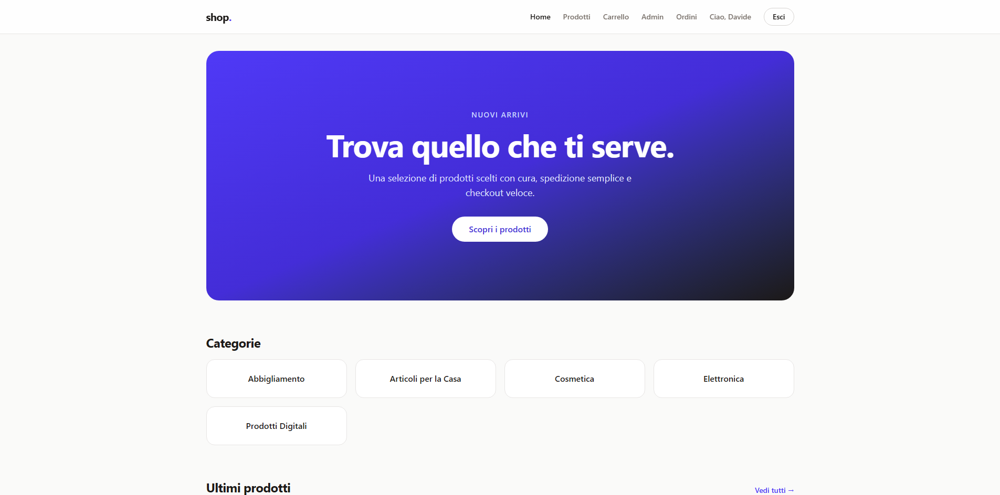
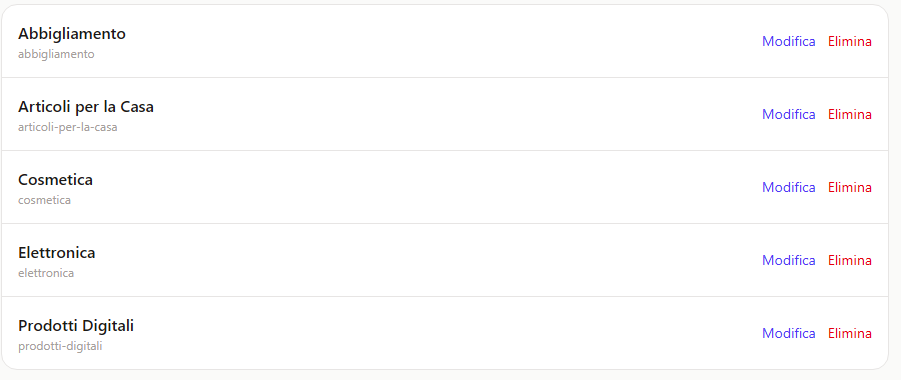

# 🛒 shop. – E-commerce full-stack

[](https://github.com/Davidebonaldi/ecommerce/actions/workflows/ci.yml)

Shop online completo con catalogo, carrello, checkout transazionale e pannello di amministrazione.

**🔗 Demo online: https://davide-shop.up.railway.app/**

> Account demo (cliente): `demo@shop.it` / `Demo12345`
> Puoi registrarti, aggiungere prodotti al carrello e completare un ordine.





## Stack

| Livello | Tecnologie |
|---|---|
| Frontend | React, Vite, Tailwind CSS, React Router |
| Backend | Node.js, Express, REST API |
| Database | MySQL |
| Sicurezza | bcrypt, JWT, Helmet, rate limiting |
| Test e CI | Vitest, Supertest, GitHub Actions |
| Deploy | Docker, nginx, Railway |

## Funzionalità

**Cliente**
- Catalogo con ricerca e filtro per categoria
- Dettaglio prodotto, carrello modificabile
- Registrazione e login
- Checkout e storico ordini

**Amministratore**
- CRUD di prodotti e categorie con upload immagini
- Gestione ordini e cambio di stato (l'annullamento ripristina lo stock)
- Gestione utenti e ruoli

**Dettagli tecnici**
- Checkout in transazione SQL (ordine, righe, stock e carrello: tutto o niente)
- Nome e prezzo salvati nelle righe d'ordine, lo storico non cambia se il prodotto viene modificato
- Rotte protette lato client e lato server (401/403)
- 14 test automatici sulle API, eseguiti a ogni push

## Architettura

```
React (nginx) ──HTTP/JSON──▶ Express ──▶ MySQL
```

Il backend è organizzato in `routes → controllers → services`.

## Avvio con Docker

```bash
cp .env.example .env    # imposta DB_PASSWORD e JWT_SECRET
docker compose up --build
```

Apri http://localhost:8080

## Sviluppo locale

Servono Node 22 e MySQL 8.

```bash
# backend
cd backend
cp .env.example .env
mysql -u root -e "CREATE DATABASE ecommerce_db CHARACTER SET utf8mb4;"
mysql -u root < database/schema.sql
npm install
npm run dev

# frontend (altro terminale)
cd frontend
npm install
npm run dev
```

Test del backend: `npm test` (richiede un database `ecommerce_test`).

## API principali

| Metodo | Percorso | Accesso |
|---|---|---|
| GET | `/api/products`, `/api/products/:id` | pubblico |
| POST/PUT/DELETE | `/api/products` | admin |
| GET | `/api/categories` | pubblico |
| POST/PUT/DELETE | `/api/categories` | admin |
| POST | `/api/auth/register`, `/api/auth/login` | pubblico |
| GET/POST/PUT/DELETE | `/api/cart` | utente |
| GET/POST | `/api/orders` | utente |
| GET/PUT/DELETE | `/api/admin/...` | admin |

## Struttura

```
frontend/   app React
backend/    API Express (controllers, routes, services, middleware)
postman/    collection per testare le API
```

## Note

La demo è su un piano di prova di Railway: se il sito non risponde, il servizio potrebbe essere in pausa.